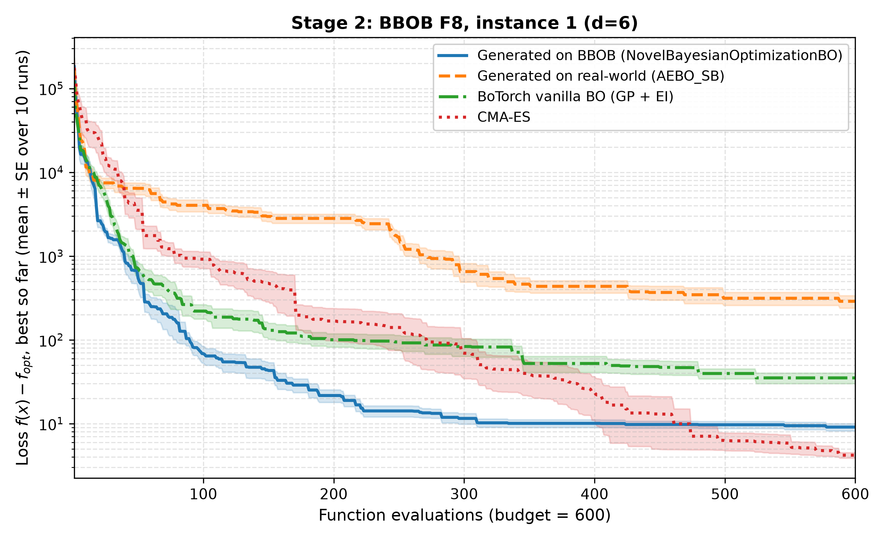

# Bayesian Optimization with LLaMEA-BO (Group 11)

This repository contains the implementation and evaluation for the **Bayesian Optimization 2026–2027 Practical Assignment** (Leiden University). We use LLaMEA (an LLM driven evolutionary algorithm) to generate Bayesian optimization algorithms for two 6-dimensional black-box problems, and then test how well each generated algorithm works on the other problem, compared with CMA-ES and a BoTorch BO baseline.

| | |
|:---|:---|
| Group | 11, seeds $s_{11,r} = 10 \cdot 11 + r = 110, \dots, 119$ |
| BBOB target | F8 (Rosenbrock, original), instance 1, $d = 6$ |
| Real-world target | Practical problem 1124 (parameter estimation of frequency modulated sound waves), $d = 6$ |
| Stage 1 | 100 candidate algorithms per search, 60 evaluations per run, 10 runs (seeds 110–119), ranked by AOCC |
| Stage 2 | 4 methods × 2 problems × 10 seeds × 600 evaluations |
| LLM | Qwen3-Coder-30B-A3B-Instruct (open weights, Q4_K_M) served locally with Ollama |

## 1. Repository structure

```text
├── configs.yaml               # all experiment settings (seeds, budgets, LLM, population, stage 2)
├── run_all.sh                 # runs everything: both stage 1 searches, reproducibility check, stage 2, plots
├── stage1_run.py              # stage 1: one LLaMEA search per target (resumable)
├── stage2_benchmark.py        # stage 2: 4 methods x 2 problems x 10 seeds (resumable)
├── check_reproducibility.py   # runs each best algorithm twice with the same seed and compares
├── run_analysis_plots.py      # stage 1 AOCC plots and stage 2 convergence plots
├── requirements.txt           # exact package versions
├── llamevol/                  # LLaMEA-BO framework (adapted, see section 6)
├── misc/                      # AOCC helpers from LLaMEA-BO
├── analysis/                  # plotting helpers from LLaMEA-BO
├── baseline/                  # BoTorch vanilla BO baseline (provided by the instructors)
├── Practical_Problems/        # real-world problem suite (provided by the instructors)
├── logs/                      # console logs of our runs (stage 1 searches, reproducibility check, stage 2, plots)
└── outputs/
    ├── bbob_f8/               # stage 1 search on F8: best algorithm, checkpoint, full search log
    ├── real_world_1124/       # stage 1 search on problem 1124: same structure
    ├── stage2_benchmark/      # stage 2: one csv per run (runs/), combined csv, final summary
    │                          # (runs_time_limited_1h/: first attempt with a 1 h limit, see 10.3)
    └── convergence_analysis/  # all figures
```

Each stage 1 search folder `outputs/<target>/ESPopulation_<name>_<timestamp>/` contains for every candidate `<generation>-<index>_<name>_<AOCC>.py` (code), `_prompt.md` (system prompt + prompt), `_respond.md` (LLM answer + evaluation feedback or error) and `_handler.pkl`, plus `history.jsonl` with one line per candidate (generation, parents, prompt, response, code, error, AOCC of each of the 10 runs, run time, token counts) and the final population pickle.

## 2. Environment setup

Python 3.12 (3.11+ works). All code runs on the CPU; a GPU is only used by the LLM server.

```bash
python -m venv .venv
source .venv/bin/activate
pip install --upgrade pip
# CPU build of torch (the experiments do not use the GPU)
pip install --extra-index-url https://download.pytorch.org/whl/cpu -r requirements.txt
```

With `uv` this is `uv venv --python 3.12 .venv && uv pip install --python .venv/bin/python --index-strategy unsafe-best-match --extra-index-url https://download.pytorch.org/whl/cpu -r requirements.txt`.

`Practical_Problems/` is included in the repository (from https://github.com/BayesOptApp/Practical_Problems), so it is not installed separately.

numpy is pinned to 2.3.5: from numpy 2.4 on, `float()` of an array with shape `(1,)` raises a `TypeError`, and generated code does this very often (the code template stores `y` with shape `(n, 1)`, so `float(self.y[i])`); with 2.3 it is only a deprecation warning.

**CPU / GPU.** The implementation runs fully on CPUs. `stage2_benchmark.py` hides the GPU (`CUDA_VISIBLE_DEVICES=""`) because the provided BoTorch baseline selects the device `cuda:3` whenever a GPU is visible, which crashes on machines with fewer than four GPUs; for GPs with at most 600 points the CPU is fast enough. With the CPU build of torch, `torch.cuda.is_available()` is `False`, so the stage 1 prompt does not ask the LLM for GPU code either. The only hardware specific part is the LLM server (section 3).

## 3. Configure the LLM

We use **Qwen3-Coder-30B-A3B-Instruct** (open weights, free) served locally with Ollama: the Ollama model `qwen3-coder:latest`, a mixture of experts model with 30.5B parameters (3.3B active), quantized to Q4_K_M (≈19 GB; with a 32K context it needs ≈22 GB of GPU memory). No api key is needed and there are no rate limits. We chose it because it is free and open weight (as the assignment requires), specialised for code, answers without long hidden reasoning (so the answer is not cut off before the code, unlike reasoning models with a token limit), and fast enough on one RTX 3090 (≈ 85 tokens/s) to run both searches within a few hours; it was released in July 2025, so newer models exist, but the choice was limited to models that run locally on the available hardware.

```bash
# on the machine with the GPU (https://ollama.com/download)
ollama pull qwen3-coder
ollama serve            # usually already running as a service on localhost:11434
```

The model is configured in `configs.yaml` under `stage1_generation.llm`: `model_name` (Ollama model name), `ollama_url` (server address) and `num_ctx` (context length). `llamevol/llm.py` talks to the native Ollama api (`/api/chat`) and passes the context length explicitly, because the OpenAI compatible endpoint of Ollama silently uses a short default context and would cut long prompts. Any other model available in Ollama can be used by changing `model_name`.

## 4. Running the experiments

Everything (both searches in parallel, the reproducibility check, stage 2 and the plots) in one command, logs go to `logs/`:

```bash
bash run_all.sh
```

Or step by step:

```bash
python stage1_run.py --target bbob          # LLaMEA search on BBOB F8
python stage1_run.py --target real_world    # LLaMEA search on problem 1124
python check_reproducibility.py             # same seed twice -> same result for both best algorithms?
python stage2_benchmark.py                  # generalization benchmark
python run_analysis_plots.py                # figures and tables in outputs/convergence_analysis/
```

`run_analysis_plots.py` reads `configs.yaml` and writes to `outputs/convergence_analysis/`:

| File | Content |
|:---|:---|
| `stage1_aocc_history.png/pdf` | AOCC of every candidate in generation order (failed ones as AOCC 0) and the best AOCC so far, both searches |
| `stage1_summary.csv` | candidates, failures, best candidate and AOCC, token usage per search |
| `stage1_<target>/es_aoc_lines.png`, `search_aoc_voilin.png`, `overall_error_rate_voilin.png` | LLaMEA-BO plots: AOCC per generation, distribution, error rate |
| `stage2_bbob_loss_convergence.png/pdf` | BBOB: best-so-far loss $f - f_{opt}$ vs evaluations, mean ± standard error over the 10 runs |
| `stage2_realworld_objective_convergence.png/pdf` | real-world problem: best-so-far objective vs evaluations, mean ± standard error |
| `stage2_statistics.csv` | final performance after 600 evaluations per method and problem (mean, std, SE, median, min, max) and a two-sided Wilcoxon rank-sum test (10 vs 10 runs) of every method against the method with the best median, Holm corrected per problem |

`outputs/stage2_benchmark/stage2_final_performance.csv` (written by stage 2) has the same summary without the tests.

Both stages can be interrupted and started again with the same command: stage 1 continues from `outputs/<target>/checkpoint_population.pkl` (saved after every generation), stage 2 skips runs whose csv already exists in `outputs/stage2_benchmark/runs/`. To start a search from scratch, delete its `outputs/<target>/` folder.

Stage 1 writes the best algorithm to `outputs/<target>/best_<target>_<ClassName>.py`; stage 2 picks these two files up automatically.

## 5. Configuring prompts and hyperparameters

All settings are in `configs.yaml`:

| Section | Parameter | Value | Meaning |
|:---|:---|:---|:---|
| experiment | `group_id`, `seeds` | 11, 110–119 | stage 2 checks that `seeds == [10*group_id + r]` |
| experiment | `dimension` | 6 | |
| targets.bbob | `function_id`, `instance` | 8, 1 | BBOB F8 Rosenbrock, instance 1 |
| targets.real_world | `problem_id` | 1124 | FM sound waves |
| targets.* | `description` | text | problem description inserted in the prompt |
| stage1_generation | `outer_budget` | 100 | candidate algorithms per search |
| stage1_generation | `inner_budget` | 60 | evaluations per run (10·d), including the initial design |
| stage1_generation | `eval_workers` | 10 | the 10 runs of a candidate in parallel processes |
| stage1_generation | `eval_timeout_seconds` | 120 | a candidate whose 10 runs take longer fails |
| population | `n_parent`, `n_offspring`, `use_elitism` | 4, 12, true | (4 + 12) elitist ES of LLaMEA-BO |
| population | `n_retry` | 3 | re-prompts if the answer contains no code |
| llm | `model_name`, `ollama_url`, `num_ctx` | `qwen3-coder:latest`, `http://localhost:11434`, 32768 | see section 3 |
| llm | `temperature` | 0.8 | sampling temperature |
| llm | `max_tokens` | 16384 | max generated tokens per answer |
| llm | `timeout_seconds`, `max_api_retries`, `max_wait_seconds` | 900, 30, 3600 | request timeout and retry/backoff of failed requests |
| stage2_generalization | `evaluation_budget` | 600 | evaluations per run (100·d), including the initial design |
| stage2_generalization | `workers` | 40 | parallel runs |
| stage2_generalization | `run_time_limit_seconds` | 10800 | safety limit: a generated algorithm run is stopped after 3 h (status in the csv); no final run reached it |
| stage2_generalization.botorch | `n_doe`, `acquisition_function` | 12, EI | Sobol initial design of 2·d points, expected improvement |
| stage2_generalization.cma_es | `sigma0_fraction` | 0.2 | σ0 = 0.2·(ub − lb) = 2, uniform random x0, restarts if CMA-ES stops early |

**Prompts.** The prompts are built in `llamevol/prompt_generators/bl_prompt_generator.py` (`BaselinePromptGenerator` with `is_bo = True`, the LLaMEA-BO baseline prompt). The task description is `__bo_task_description`, the code template is `__bo_code_structure`, the answer format (`# Description / # Justification / # Code`) is `response_format`, and the feedback after an evaluation is `evaluation_feedback_prompt` (mean and std of the AOCC and the run time). Two parts are set from `stage1_run.py`: `reproducibility_prompt` and `runtime_prompt` (section 6). Mutation and crossover prompts include the parent code and a summary of the current population.

**Selection metric (AOCC).** Every candidate is run once per seed (110–119) with 60 evaluations. For each run the evaluator (`ConvergenceCurveAnalyzer` in `llamevol/evaluator/evaluator_result.py`, as in LLaMEA-BO) takes the best-so-far curve of the loss $f(x_t) - f_{opt}$, clips it to $[10^{-8}, 10^{9}]$ (LLaMEA-BO uses the upper bound $10^9$ for $d > 5$), scales it on a log10 scale to $[0, 1]$ and computes

$$\text{AOCC} = 1 - \int_0^1 \frac{\log_{10} \text{clip}(\min_{s \le t} f(x_s) - f_{opt}) - \log_{10} 10^{-8}}{\log_{10} 10^{9} - \log_{10} 10^{-8}} \, dt$$

with the trapezoidal rule over the evaluations (1 is best). The fitness of a candidate is the mean AOCC over the 10 runs; candidates that crash, exceed the budget or time out get AOCC 0. For BBOB F8, $f_{opt}$ is the known optimum of instance 1 ($f_{opt} = 149.15$, `ioh.get_problem(8, 1, 6).optimum.y`). For problem 1124 the optimum is unknown and the suite uses $f_{opt} = 0$ (the objective is a sum of squared errors between the generated and the target sound wave, so it is non-negative and 0 means a perfect fit), so its AOCC is computed on the raw objective. The best algorithm of each search is selected only by its AOCC on its own target.

**Generated algorithms.** Their hyperparameters (initial design size, kernel, acquisition settings, trust region constants) are constants in `__init__` of the generated files `outputs/<target>/best_*.py` and can be edited there.

## 6. Modifications to LLaMEA and why

The `llamevol/` package is LLaMEA-BO (see credits). All our changes are marked with `# Group 11 change` in the code.

1. **LLM client** (`llamevol/llm.py`). The original file has clients for many api providers; we replaced them with a single client for the native Ollama api that sets the context length explicitly. A failed request (server busy, timeout) was originally returned at once and the candidate became an empty, failed candidate; now it is retried with exponential backoff, so only real answers of the LLM count as candidates.
2. **Reason of every failed try in the logs** (`llamevol/llamevol.py`). The request error or the finish reason (e.g. `length` when `max_tokens` is used up) is stored in the error of the candidate, so it appears in `_respond.md` and `history.jsonl`.
3. **Complete search history** (`population.py`). Every candidate is appended to `history.jsonl`, and the population is checkpointed after every generation so a search can be resumed (`stage1_run.py` moves the files of an unfinished generation to `discarded_unfinished_generation/`).
4. **Budget check** (`ioh_evaluator.py`). The over-budget check used `> budget`, which allowed 61 evaluations in a 60 evaluation run; now `>= budget`.
5. **Timeout really stops a candidate** (`ioh_evaluator.py`). After a timeout the executor waited for the running processes, so a hanging candidate blocked the search. Now the worker processes are terminated. Together with `eval_timeout_seconds` this keeps one search at a few hours.
6. **Parallel evaluation in processes** (`stage1_run.py`). The 10 runs of a candidate run in 10 processes (threads would share the global `np.random` state that is seeded per run).
7. **Reproducibility rule in the prompt** (`reproducibility_prompt`). The evaluator seeds `np.random` and `torch` before each run, but generated code often creates unseeded generators (e.g. `qmc.Sobol(scramble=True)`), so the same seed gave different results. The prompt now asks to derive every generator from `np.random`; `check_reproducibility.py` confirms that both best algorithms are reproducible.
8. **Run time rule in the prompt** (`runtime_prompt`). Tells the LLM about the timeout and that the algorithm is later run with 600 evaluations, so it should not become too expensive per iteration.
9. **Problem description.** The original prompt said "evaluated on the BBOB test suite of ..." also for the real-world problem; it now uses the description from `configs.yaml`.
10. **Real-world problems and seeds in the evaluator** (`ioh_evaluator.py`). LLaMEA-BO only supports BBOB functions; problem ids ≥ 1000 now load the practical problem from `Practical_Problems/`, dimension 6 is allowed, and every run seeds `np.random` and `torch` with its own seed (110–119) instead of using unseeded runs.

## 7. Randomness and reproducibility

* Every run (stage 1 and 2) seeds `random`, `np.random` and `torch` with its seed from 110–119 before the algorithm is created. BoTorch gets `random_seed=seed`, CMA-ES `seed=seed` (and `seed + evaluations used` on a restart).
* `check_reproducibility.py` runs both best algorithms twice per problem with seed 110 and checks that the results are identical (result in `logs/reproducibility.log`).
* **Not controlled:** the LLM sampling (temperature 0.8, no seed), so a new search gives different algorithms; the order in which parallel candidates finish does not change the result. Floating point results of BLAS libraries can differ between machines/library versions.

## 8. Machines

| Machine | Used for | Hardware | Software |
|:---|:---|:---|:---|
| vibranium.liacs.nl (LIACS REL Compute) | stage 1 (LLM + evaluation), stage 2, plots | 2× Intel Xeon Silver 4214R @ 2.40 GHz (48 threads), 251 GB RAM, 2× NVIDIA GeForce RTX 3090 (24 GB), driver 615.71 | Rocky Linux 9.8, Python 3.12, torch 2.15.0+cpu, Ollama 0.32.5 |

Run times on this machine: stage 1 BBOB search 1 h 51 min and real-world search 1 h 20 min (in parallel, 10 cores each, sharing the LLM), stage 2 about 1 h 15 min with 40 parallel runs (the slowest method needs ≈ 65 min per run).

The machine is shared with other users. The LLM was served by the machine's Ollama service on its GPUs; all optimization runs used one CPU core each (`OMP_NUM_THREADS=1`).

## 9. Generated algorithms

### 9.1 The two searches

| | BBOB F8 search | Real-world 1124 search |
|:---|:---|:---|
| candidates (generations) | 100 (4 + 8 × 12) | 100 (4 + 8 × 12) |
| failed candidates | 20 (5 timeouts, 5 syntax errors, 3 ValueError, 3 TypeError, 1 over budget, 3 other) | 22 (10 syntax errors, 4 NameError, 3 over budget, 2 IndexError, 2 ValueError, 1 TypeError) |
| best AOCC in generation 0 → final | 0.333 → **0.350** | 0.448 → **0.460** |
| best algorithm | `NovelBayesianOptimizationBO` (candidate 89, generation 8) | `AEBO_SB` (candidate 94, generation 8) |
| lineage of the best (mutations) | #4 (gen 0, 0.333) → #20 (gen 2, 0.343) → #89 (gen 8, 0.350) | #2 `EGOABLBO` (0.449) → #24 → #47 → #62 `AEBO` (0.452) → #74 (0.455) → #84 → #94 `AEBO_SB` (0.460) |
| LLM tokens (prompt / answer) | 397K / 323K | 358K / 279K |
| wall clock time | 1 h 51 min | 1 h 20 min |

The improvement during the searches is small (AOCC +0.017 and +0.012). Most of the gain comes from tuning the exploration/exploitation schedule; the LLM rarely changes the overall structure (GP + EI on a candidate pool) once a working design is in the population. The failure rate drops after the first generations because the elitist population only keeps working parents.

### 9.2 BBOB F8: `NovelBayesianOptimizationBO`

File: `outputs/bbob_f8/best_bbob_f8_NovelBayesianOptimizationBO.py`

```text
n_init = max(10, min(20, ceil(5·sqrt(d)))) = 13            # d = 6
X, y  <- evaluate n_init Latin hypercube points in [-5, 5]^d
batch <- 1 if budget <= 200 else ceil(4·max(0.1, 1 - 0.8·t/budget)) clipped to [1, 5]
while evaluations + batch <= budget:
    C   <- 50 LHS points  ∪  12 Gaussian perturbations of x_best (σ = min(1, 10·sqrt(d)/budget^0.6), clipped)
    C   <- C ∪ LHS points until |C| >= 100
    GP  <- fit GP(Constant × Matern 5/2) on (X, y), normalize_y, 5 optimizer restarts
    a(x) = EI(x) · (0.5 + 0.5·(1 - (t/budget)^1.5))       # scaled EI
    top <- 5 candidates with largest a(x)
    GP is fitted again and the `batch` best of `top` are evaluated
    update batch size (only for budget > 200; 1 for the last 50 evaluations)
return best (y, x)
```

| Component | Choice | Compared with a standard BO pipeline |
|:---|:---|:---|
| Initial design | 13 LHS points (22 % of the 60 evaluation budget) | standard (2·d to 10·d space filling points) |
| Surrogate | sklearn GP, Constant × Matern ν = 5/2 (isotropic length scale), noise 1e-6, `normalize_y`, ML-II with 5 restarts | standard, but refitted from scratch twice per iteration |
| Acquisition | Expected improvement multiplied by a factor that decays from 1 to 0.5 over the budget | the factor multiplies EI by a constant per iteration, so it does **not** change which point is chosen; it is effectively plain EI |
| Acquisition optimizer | no gradient optimizer: argmax over ~100 LHS points + 12 local perturbations around the incumbent | standard BO uses multi-start L-BFGS; here the local perturbations give a trust-region-like exploitation of the best point, which suits the narrow curved valley of Rosenbrock |
| Batch | 1 point per iteration for budget ≤ 200 (stage 1); up to 4 points (top EI values, no fantasies) for budget 600 | batch selection without penalisation can pick nearby points |
| Unused parts | `_model_selection` ("cross validation") only fits the same GP | LLM artefact |

### 9.3 Real-world 1124: `AEBO_SB`

File: `outputs/real_world_1124/best_real_world_1124_AEBO_SB.py` ("adaptive exploration BO with space-filling batches"; the class name contains "BO" but does not end with it).

```text
n_init = max(5, min(20, 2d)) = 12
X, y  <- evaluate n_init scrambled Sobol points; GP <- fit
while evaluations < budget:
    explore <- evaluations <= 0.4·budget                       # first 40 % of the budget
    batch   <- 1..5, larger (up to remaining/10) when the best value stopped improving
    if explore or evaluations < 10:
        evaluate `batch` new space filling points (LHS if batch <= 10, else Sobol)   # no model used
    else:
        C <- 100 scrambled Sobol points
        a(x) = EI(x)                                              # GP posterior
        evaluate the `batch` points of C with the largest a(x)
    refit the GP when > 15 points and > 3 new evaluations since the last fit
        (GP on a random subset of at most 100 points, 0 optimizer restarts)
return best (y, x)
```

| Component | Choice | Compared with a standard BO pipeline |
|:---|:---|:---|
| Initial design | 12 Sobol points, then **pure space filling until 40 % of the budget** (24 of 60 evaluations) | much longer exploration phase than standard BO; the acquisition function `EI + σ` written for this phase is never used, because points are sampled without the model then |
| Surrogate | sklearn GP, Constant × Matern 5/2 + white noise, `normalize_y`, **no restarts**, at most 100 (random) points | cheap: constant cost per fit even with 600 evaluations, but forgets most data at large budgets |
| Acquisition | expected improvement | standard |
| Acquisition optimizer | argmax over 100 random Sobol points | very coarse (random search on EI); no local refinement around the incumbent |
| Batch | 1–5 points per iteration, bigger when progress stalls | top-k EI without diversity |
| Robustness | failed evaluations get a penalty value 1e6 | |

On the FM sound wave problem (very multimodal, flat regions) a long space filling phase followed by coarse EI screening works well at 60 evaluations, which explains why the search converged to this exploratory design.

### 9.4 Differences between the two

The BBOB algorithm exploits: local perturbations around the incumbent and a short initial design, which suits the single curved valley of Rosenbrock. The real-world algorithm explores: 40 % of the budget is space filling and EI is only maximised over random points, which suits the rugged FM problem. Both keep the GP + EI core of standard BO but replace the gradient based acquisition optimizer with cheap candidate pools.

## 10. Results

All numbers below are produced by `stage2_benchmark.py` and `run_analysis_plots.py` (`outputs/stage2_benchmark/stage2_final_performance.csv`, `outputs/convergence_analysis/stage2_statistics.csv`). 4 methods × 2 problems × 10 seeds, 600 evaluations each, all 80 runs used the full budget (`Run_Status = ok`).

### 10.1 Convergence plots

| BBOB F8 (loss) | Real-world 1124 (objective) |
|:---:|:---:|
|  |  |

Stage 1 search progress: `outputs/convergence_analysis/stage1_aocc_history.png` and the LLaMEA-BO plots in `outputs/convergence_analysis/stage1_*/`.

### 10.2 Final performance after 600 evaluations

Mean ± standard error over 10 runs, median, and the two-sided Wilcoxon rank-sum test against the method with the best median (Holm corrected per problem).

| Problem | Method | Mean ± SE | Median | p vs best (Holm) |
|:---|:---|:---:|:---:|:---:|
| BBOB F8 (loss $f - f_{opt}$) | **CMA-ES** | **4.20 ± 0.32** | **4.39** | — |
| | Generated on BBOB (`NovelBayesianOptimizationBO`) | 9.10 ± 0.90 | 8.68 | 0.0005 |
| | BoTorch vanilla BO | 35.2 ± 5.1 | 37.0 | 0.0005 |
| | Generated on real-world (`AEBO_SB`) | 288.5 ± 49.0 | 265.8 | 0.0005 |
| Real-world 1124 (objective $f$) | **CMA-ES** | **1.84 ± 0.17** | **1.92** | — |
| | Generated on BBOB (`NovelBayesianOptimizationBO`) | 2.22 ± 0.20 | 2.19 | 0.21 |
| | BoTorch vanilla BO | 2.32 ± 0.15 | 2.29 | 0.18 |
| | Generated on real-world (`AEBO_SB`) | 2.71 ± 0.14 | 2.66 | 0.007 |

Median best-so-far at intermediate budgets (loss for F8, objective for 1124):

| Problem | Method | 60 evals | 150 | 300 | 600 |
|:---|:---|:---:|:---:|:---:|:---:|
| BBOB F8 | Generated on BBOB | **155** | **37.5** | **9.98** | 8.68 |
| | Generated on real-world | 4450 | 3218 | 555 | 266 |
| | BoTorch | 319 | 130 | 53.0 | 37.0 |
| | CMA-ES | 1021 | 230 | 20.0 | **4.39** |
| Real-world 1124 | Generated on BBOB | 4.07 | 3.54 | 2.77 | 2.19 |
| | Generated on real-world | 12.1 | 5.51 | 3.74 | 2.66 |
| | BoTorch | **3.66** | **3.41** | 2.71 | 2.29 |
| | CMA-ES | 4.50 | 3.80 | **2.21** | **1.92** |

Mean wall clock time per run (one CPU core): `NovelBayesianOptimizationBO` 65 min, BoTorch 21 min, `AEBO_SB` 16 s, CMA-ES < 1 s.

### 10.3 Discussion

**Specialization of the BBOB algorithm.** On its own target `NovelBayesianOptimizationBO` is clearly the best method for the first ~400 evaluations (median loss 155 after 60 evaluations vs 319 for BoTorch and 1021 for CMA-ES; 10 vs 53 and 20 after 300). Its local perturbations around the incumbent follow the Rosenbrock valley well. After ~300 evaluations it stagnates around a loss of 9: the perturbation size is fixed for a given budget, the kernel is isotropic and the EI argmax is taken over a random pool, so it cannot refine the narrow valley any further. CMA-ES, which adapts its step size and covariance, overtakes it after ~400 evaluations and is significantly better at 600. It is also the most expensive method (it refits the GP twice per iteration).

**Specialization of the real-world algorithm.** `AEBO_SB` was the best of 100 candidates on problem 1124 with 60 evaluations, but with 600 evaluations it is the worst method on its own target (median 2.66, significantly worse than CMA-ES). The reason is that its design is tied to the budget, not to the problem: the pure space filling phase is 40 % of the budget (24 evaluations in stage 1, 240 in stage 2), and the GP is fitted on at most 100 random points, so most of the data is ignored at large budgets. After 60 evaluations of the 600 budget it is still sampling at random (median 12.1). The algorithm is specialised to the stage 1 setting (budget 60) rather than to the problem.

**Generalization.** The algorithm generated on BBOB transfers well: on problem 1124 it is second (median 2.19) and not significantly different from CMA-ES (p = 0.21) or BoTorch (p = 0.18). The algorithm generated on the real-world problem does not transfer: on F8 its exploratory design is far behind all other methods (median loss 266, 30× worse than the BBOB algorithm), because random space filling cannot find the narrow curved valley of Rosenbrock. In this experiment the more exploitative, budget-independent design generalizes better than the exploratory one.

**Baselines.** CMA-ES has the best final value on both problems, while the BO methods are better at small budgets (for F8 the BBOB algorithm and BoTorch lead until 300–400 evaluations). The early lead of BoTorch on problem 1124 (objective ≈ 3.7 after 12 evaluations in every run) comes from its initial design, not from the model: the provided baseline uses a *centred* Latin hypercube (`criterion="center"`), so every design contains the grid value $x_1 = 0.417$, which corresponds to an almost zero amplitude of the generated sound wave and gives $f \approx 4$ (the "silent signal" plateau) whatever the other variables are. Uniformly random points reach $f < 4.3$ with probability ≈ 0.4 %.

**Limitations.** The LLaMEA searches improved the AOCC only slightly (+0.017 and +0.012) and the AOCC with bounds $[10^{-8}, 10^{9}]$ compresses differences between candidates. Selecting with 60 evaluations favours algorithms tuned to that budget, as `AEBO_SB` shows; evaluating candidates also at a larger budget would be a natural extension. One search per target was run, so the variability of the LLaMEA search itself is not measured.

**Note on the stage 2 time limit.** In a first stage 2 run the generated algorithm runs were limited to 1 h; all 20 runs of `NovelBayesianOptimizationBO` stopped after 558–589 evaluations. These runs are kept in `outputs/stage2_benchmark/runs_time_limited_1h/` and were repeated with a 3 h limit, where they all finished the 600 evaluations (≤ 74 min). The 60 other runs were not repeated.

## 11. External code attribution

* **`llamevol/`, `misc/`, `analysis/`**: adapted from **LLaMEA-BO** by Wenhu Li, Niki van Stein, Thomas Bäck and Elena Raponi, https://github.com/BayesOptApp/LLaMEA-BO/ (based on LLaMEA, https://github.com/XAI-liacs/LLaMEA).
* **`baseline/`, `Practical_Problems/`**: provided by the course instructors (Iván Olarte Rodríguez, Elena Raponi, Santiago García Mayayo), https://github.com/BayesOptApp/BO_Course_Assignment.
* **CMA-ES**: pycma, https://github.com/CMA-ES/pycma.
