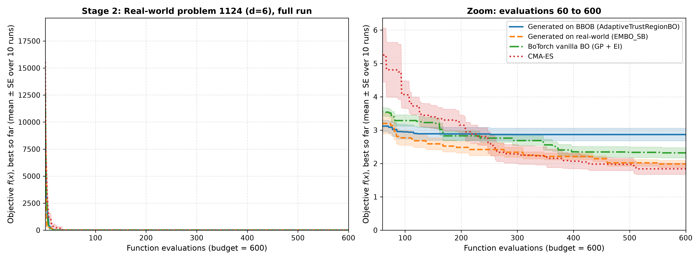

# Bayesian Optimization with LLaMEA-BO (Group 11)

This repository contains the implementation and evaluation for the **Bayesian Optimization 2026–2027 Practical Assignment** (Leiden University). We use LLaMEA (an LLM driven evolutionary algorithm) to generate Bayesian optimization algorithms for two 6-dimensional black-box problems, and then test how well each generated algorithm works on the other problem, compared with CMA-ES and a BoTorch BO baseline.

| | |
|:---|:---|
| Group | 11, seeds $s_{11,r} = 10 \cdot 11 + r = 110, \dots, 119$ |
| BBOB target | F8 (Rosenbrock, original), instance 1, $d = 6$ |
| Real-world target | Practical problem 1124 (parameter estimation of frequency modulated sound waves), $d = 6$ |
| Stage 1 | 100 candidate algorithms per search, 60 evaluations per run, 10 runs (seeds 110–119), ranked by AOCC |
| Stage 2 | 4 methods × 2 problems × 10 seeds × 600 evaluations, compared by final value and by AOCC |
| LLM | Qwen3-32B (open weights, Q4_K_M) with thinking mode, served locally with Ollama |
| Prompts | LLaMEA-BO prompts extended with a BO design space and random mutation operators (refine / replace a component / new idea) for more diverse algorithms (section 5.3) |

## 1. Repository structure

```text
├── configs.yaml               # all experiment settings (seeds, budgets, LLM, prompt, population, stage 2)
├── run_all.sh                 # runs everything: both stage 1 searches, reproducibility check, stage 2, plots, diversity
├── stage1_run.py              # stage 1: one LLaMEA search per target (resumable)
├── stage2_benchmark.py        # stage 2: 4 methods x 2 problems x 10 seeds (resumable)
├── check_reproducibility.py   # runs each best algorithm twice with the same seed and compares
├── run_analysis_plots.py      # stage 1 AOCC plots, stage 2 convergence plots and statistics
├── analyze_diversity.py       # component and code diversity of the LLaMEA searches (section 11)
├── requirements.txt           # exact package versions
├── llamevol/                  # LLaMEA-BO framework (adapted, see section 6)
├── misc/                      # AOCC helpers from LLaMEA-BO
├── analysis/                  # plotting helpers from LLaMEA-BO
├── baseline/                  # BoTorch vanilla BO baseline (provided by the instructors)
├── Practical_Problems/        # real-world problem suite (provided by the instructors)
├── logs/                      # console logs of our runs (stage 1 searches, reproducibility check, stage 2, plots, diversity)
└── outputs/
    ├── bbob_f8/               # stage 1 search on F8: best algorithm, checkpoint, full search log
    ├── real_world_1124/       # stage 1 search on problem 1124: same structure
    ├── stage2_benchmark/      # stage 2: one csv per run (runs/), combined csv, final summary
    │                          # (runs_thread_crash/: 5 runs that crashed because of the machine, see 10.4)
    └── convergence_analysis/  # all figures and tables
```

Each stage 1 search folder `outputs/<target>/ESPopulation_<name>_<timestamp>/` contains for every candidate `<generation>-<index>_<name>_<AOCC>.py` (code), `_prompt.md` (system prompt + prompt), `_respond.md` (the reasoning of the model, its answer and the evaluation feedback or error) and `_handler.pkl`, plus `history.jsonl` with one line per candidate (generation, parents, prompt, response, code, error, AOCC of each of the 10 runs, run time, token counts) and the final population pickle.

The runs were made with the config file under the name `configs_qwen32.yaml` and the output folder `outputs_qwen32/`, which were renamed to `configs.yaml` and `outputs/` afterwards (only the `save_dir` line changed), so these names still appear in the logs.

## 2. Environment setup

Python 3.12 (3.11+ works). All optimization code runs on the CPU; a GPU is only used by the LLM server.

```bash
python -m venv .venv
source .venv/bin/activate
pip install --upgrade pip
# CPU build of torch (the experiments do not use the GPU)
pip install --extra-index-url https://download.pytorch.org/whl/cpu -r requirements.txt
```

With `uv` this is `uv venv --python 3.12 .venv && uv pip install --python .venv/bin/python --index-strategy unsafe-best-match --extra-index-url https://download.pytorch.org/whl/cpu -r requirements.txt`.

`Practical_Problems/` is included in the repository (from https://github.com/BayesOptApp/Practical_Problems), so it is not installed separately.

numpy is pinned to 2.3.5: from numpy 2.4 on, `float()` of an array with shape `(1,)` raises a `TypeError`, and generated code does this very often (the code template stores `y` with shape `(n, 1)`, so `float(self.y[i])`); with 2.3 it is only a deprecation warning.

**CPU / GPU.** The implementation runs fully on CPUs. `stage2_benchmark.py` hides the GPU (`CUDA_VISIBLE_DEVICES=""`) because the provided BoTorch baseline selects the device `cuda:3` whenever a GPU is visible, which crashes on machines with fewer than four GPUs; for GPs with at most 600 points the CPU is fast enough. With the CPU build of torch, `torch.cuda.is_available()` is `False`, so the stage 1 prompt does not ask the LLM for GPU code either. The only hardware specific part is the LLM server (section 3).

## 3. Configure the LLM

We use **Qwen3-32B** (open weights, free) served locally with Ollama: the Ollama model `qwen3:32b`, a dense model with 32.8B parameters quantized to Q4_K_M (≈ 20 GB), with its **thinking mode** switched on, so the model reasons about the design before it writes the answer (≈ 35 tokens/s on an RTX 3090). No api key is needed and there are no rate limits. We chose it because it is free and open weight (as the assignment requires), it is the largest general model that runs at a usable speed on the available GPUs, and the reasoning step suits a task where the model has to combine several design decisions into working code; in preliminary runs the smaller Qwen3-Coder-30B-A3B (no thinking) was about 3 times faster per answer and produced more working code, but Qwen3-32B found the best algorithm on the real-world problem (on F8 the preliminary runs found better algorithms). The price is speed: with the reasoning, an answer has ≈ 4,600 tokens on average, and one search takes ≈ 7.5 h.

```bash
# on the machine with the GPU (https://ollama.com/download)
ollama pull qwen3:32b
ollama serve            # usually already running as a service on localhost:11434
```

The model is configured in `configs.yaml` under `stage1_generation.llm`: `model_name` (Ollama model name), `ollama_url` (server address), `num_ctx` (context length) and `think` (thinking mode on/off; leave it out for models without a thinking mode). `llamevol/llm.py` talks to the native Ollama api (`/api/chat`) and passes the context length explicitly, because the OpenAI compatible endpoint of Ollama silently uses a short default context and would cut long prompts. The reasoning text of the model is only saved in the logs (`_respond.md`, `history.jsonl`); only the answer is used to extract the code. Any other model available in Ollama can be used by changing `model_name`.

## 4. Running the experiments

Everything (both searches in parallel, the reproducibility check, stage 2, the plots and the diversity analysis) in one command, logs go to `logs/`:

```bash
bash run_all.sh
```

Or step by step:

```bash
python stage1_run.py --target bbob          # LLaMEA search on BBOB F8
python stage1_run.py --target real_world    # LLaMEA search on problem 1124
python check_reproducibility.py             # same seed twice -> same result for both best algorithms?
python stage2_benchmark.py                  # generalization benchmark
python run_analysis_plots.py                # figures and tables in outputs/convergence_analysis/
python analyze_diversity.py outputs         # diversity of the two searches
```

All scripts read `configs.yaml`; another config file can be given with `--config <file>` (stage 1 and 2) or as the last argument (`run_analysis_plots.py <file>`, `check_reproducibility.py <n_evals> <file>`).

`run_analysis_plots.py` writes to `outputs/convergence_analysis/`:

| File | Content |
|:---|:---|
| `stage1_aocc_history.png/pdf` | AOCC of every candidate in generation order (failed ones as AOCC 0) and the best AOCC so far, both searches |
| `stage1_summary.csv` | candidates, failures, best candidate and AOCC, token usage per search |
| `stage1_<target>/es_aoc_lines.png`, `search_aoc_voilin.png`, `overall_error_rate_voilin.png` | LLaMEA-BO plots: AOCC per generation, distribution, error rate |
| `stage2_bbob_loss_convergence.png/pdf` | BBOB: best-so-far loss $f - f_{opt}$ vs evaluations, mean ± standard error over the 10 runs |
| `stage2_realworld_objective_convergence.png/pdf` | real-world problem: best-so-far objective vs evaluations, mean ± standard error |
| `stage2_statistics.csv` | per method and problem: the final value after 600 evaluations (mean, std, SE, median, min, max) and the AOCC of the runs (mean, std, median), each with a two-sided Wilcoxon rank-sum test (10 vs 10 runs) against the best method (best median), Holm corrected per problem |

`outputs/stage2_benchmark/stage2_final_performance.csv` (written by stage 2) has the final value summary without the tests. `analyze_diversity.py` writes `outputs/convergence_analysis/diversity.csv`.

Both stages can be interrupted and started again with the same command: stage 1 continues from `outputs/<target>/checkpoint_population.pkl` (saved after every generation), stage 2 skips runs whose csv already exists in `outputs/stage2_benchmark/runs/`. To start a search from scratch, delete its `outputs/<target>/` folder.

Stage 1 writes the best algorithm to `outputs/<target>/best_<target>_<ClassName>.py`; stage 2 picks these two files up automatically.

## 5. Configuring prompts and hyperparameters

### 5.1 Settings

All settings are in `configs.yaml`:

| Section | Parameter | Value | Meaning |
|:---|:---|:---|:---|
| experiment | `group_id`, `seeds` | 11, 110–119 | stage 2 checks that `seeds == [10*group_id + r]` |
| experiment | `dimension` | 6 | |
| targets.bbob | `function_id`, `instance` | 8, 1 | BBOB F8 Rosenbrock, instance 1 |
| targets.real_world | `problem_id` | 1124 | FM sound waves |
| targets.* | `description` | text | problem description inserted in the prompt |
| stage1_generation | `outer_budget` | 100 | candidate algorithms per search |
| stage1_generation | `inner_budget` | 60 | evaluations per run (10·d), including the initial design |
| stage1_generation | `prompt_variant` | `diverse` | `diverse`: design space + random mutation operators (section 5.3); `baseline`: the original LLaMEA-BO prompts |
| stage1_generation | `eval_workers` | 10 | the 10 runs of a candidate in parallel processes |
| stage1_generation | `eval_timeout_seconds` | 120 | a candidate whose 10 runs take longer fails |
| population | `n_parent`, `n_offspring`, `use_elitism` | 4, 12, true | (4 + 12) elitist ES of LLaMEA-BO |
| population | `n_retry` | 3 | re-prompts if the answer contains no code |
| llm | `model_name`, `ollama_url`, `num_ctx`, `think` | `qwen3:32b`, `http://localhost:11434`, 32768, true | see section 3 |
| llm | `temperature` | 0.8 | sampling temperature |
| llm | `max_tokens` | 16384 | max generated tokens per answer (reasoning + answer); no answer reached it |
| llm | `timeout_seconds`, `max_api_retries`, `max_wait_seconds` | 900, 30, 3600 | request timeout and retry/backoff of failed requests |
| stage2_generalization | `evaluation_budget` | 600 | evaluations per run (100·d), including the initial design |
| stage2_generalization | `workers` | 40 | parallel runs |
| stage2_generalization | `run_time_limit_seconds` | 10800 | safety limit: a generated algorithm run is stopped after 3 h (status in the csv); no run reached it |
| stage2_generalization.botorch | `n_doe`, `acquisition_function` | 12, EI | initial design of 2·d points, expected improvement |
| stage2_generalization.cma_es | `sigma0_fraction` | 0.2 | σ0 = 0.2·(ub − lb) = 2, uniform random x0, restarts if CMA-ES stops early |

### 5.2 Prompts

The prompts are built in `llamevol/prompt_generators/bl_prompt_generator.py` (`BaselinePromptGenerator` with `is_bo = True`, the LLaMEA-BO prompt). The task description is `__bo_task_description`, the code template is `__bo_code_structure`, the answer format (`# Description / # Justification / # Code`) is `response_format`, and the feedback after an evaluation is `evaluation_feedback_prompt` (mean and std of the AOCC and the run time). Two parts are set from `stage1_run.py`: `reproducibility_prompt` and `runtime_prompt` (section 6). Mutation and crossover prompts include the parent code and a summary of the current population.

### 5.3 Prompts for more diverse algorithms

With the original LLaMEA-BO prompts the LLM tends to produce the same kind of algorithm again and again: every mutation asks *"Refine the strategy of the selected solution to improve it."*, so the offspring are small variations of their parent, and nothing in the prompt suggests alternatives to the default choices of the model (in a preliminary run with these prompts every working candidate used a scikit-learn GP with expected improvement). To make the search explore different designs we changed two things (`prompt_variant: "diverse"`, `DESIGN_SPACE`, `DIVERSE_MUTATIONS`, `__design_space_prompt` and `__diverse_mutation` in `llamevol/prompt_generators/bl_prompt_generator.py`). The temperature (0.8) and everything else is unchanged.

**1. Design space in the task description.** Every prompt (initial generation and mutations) contains this list after the problem description:

```text
A BO algorithm can be built from many different components, for example:
- initial design: Sobol, Latin hypercube, random, maximin designs, different sizes (e.g. d+1 up to 4d points)
- surrogate model: GP with an anisotropic (ARD) Matern or RBF kernel, GP on log-transformed or rank-transformed y,
  random forest or extra trees (uncertainty from the spread of the trees), an ensemble of models, a local GP fitted
  only near the best point
- acquisition function: expected improvement, log expected improvement, lower confidence bound with a schedule for
  the exploration weight, probability of improvement, Thompson sampling from the GP posterior, a portfolio that
  switches between several acquisition functions
- acquisition function optimizer: L-BFGS-B from several starting points, differential evolution, a small evolution
  strategy, random candidates plus local refinement, candidates sampled around the best points
- exploration strategy: a trust region around the best point that grows and shrinks (as in TuRBO), restarts when
  progress stops, a switch from global to local search, batches of diverse points
Do not always use the same default choices (e.g. a scikit-learn GP with expected improvement on random candidates);
choose the components that suit the problem.
```

**2. Random mutation operators.** Instead of always "refine", every mutation prompt ends with one of three operators, chosen uniformly at random:

| Operator | Text in the prompt | Purpose |
|:---|:---|:---|
| refine | *"Refine the strategy of the selected solution to improve it."* (the original text) | local improvement of a good design |
| replace component | *"Replace the {component} of the selected solution by a substantially different alternative (options: {options}), and adapt the rest of the algorithm where needed. Explain in the justification why the new {component} should work better."* The component is chosen uniformly from the five components above, and its options from the list are inserted. | structural change of one part of the algorithm |
| new idea | *"Use the selected solution only as a reference: design a new BO algorithm whose main idea is clearly different from all algorithms in the current population (for example a different surrogate model, acquisition function or search strategy), and explain the difference in the justification."* | jump to a different design (the prompt also contains a summary of the current population) |

The operators are drawn with Python's `random.Random(110)` (seeded with the first seed of the group), so the sequence of operators is reproducible and the same in both searches; the operator of every candidate can be read in its saved prompt (`_prompt.md`, `history.jsonl`). With the original prompts this behaviour is obtained with `prompt_variant: "baseline"`.

**How often they were used and what they gave** (both searches, the 96 offspring after generation 0; the same operator sequence in both searches):

| Operator | Used | Working offspring (BBOB / real-world) | Better than the parent (BBOB / real-world) |
|:---|:---:|:---:|:---:|
| refine | 40 | 21 / 18 | 7 / 3 |
| replace component | 29 (exploration strategy 8, surrogate 7, acquisition function 5, acquisition optimizer 5, initial design 4) | 15 / 20 | 5 / 6 |
| new idea | 27 | 12 / 15 | 5 / 1 |

The effect on the searches is described in section 11.1 (several surrogates and acquisition functions, 18–21 distinct component combinations) and visible in the lineages of the two best algorithms (section 9.1), which change structure several times (e.g. GP + EI → Thompson sampling → trust region ensemble → random forest).

### 5.4 Selection metric (AOCC)

Every candidate is run once per seed (110–119) with 60 evaluations. For each run the evaluator (`ConvergenceCurveAnalyzer` in `llamevol/evaluator/evaluator_result.py`, as in LLaMEA-BO) takes the best-so-far curve of the loss $f(x_t) - f_{opt}$, clips it to $[10^{-8}, 10^{9}]$ (LLaMEA-BO uses the upper bound $10^9$ for $d > 5$), scales it on a log10 scale to $[0, 1]$ and computes

$$\text{AOCC} = 1 - \int_0^1 \frac{\log_{10} \text{clip}(\min_{s \le t} f(x_s) - f_{opt}) - \log_{10} 10^{-8}}{\log_{10} 10^{9} - \log_{10} 10^{-8}} \, dt$$

with the trapezoidal rule over the evaluations (1 is best). The fitness of a candidate is the mean AOCC over the 10 runs; candidates that crash, exceed the budget or time out get AOCC 0. For BBOB F8, $f_{opt}$ is the known optimum of instance 1 ($f_{opt} = 149.15$, `ioh.get_problem(8, 1, 6).optimum.y`). For problem 1124 the optimum is unknown and the suite uses $f_{opt} = 0$ (the objective is a sum of squared errors between the generated and the target sound wave, so it is non-negative and 0 means a perfect fit), so its AOCC is computed on the raw objective. The best algorithm of each search is selected only by its AOCC on its own target. In stage 2 the same AOCC is computed for every run with 600 evaluations (`run_analysis_plots.py`), so the methods are also compared on their anytime performance.

### 5.5 Hyperparameters of the generated algorithms

Their hyperparameters (initial design size, kernel, acquisition settings, trust region constants) are constants in `__init__` of the generated files `outputs/<target>/best_*.py` and can be edited there.

## 6. Modifications to LLaMEA and why

The `llamevol/` package is LLaMEA-BO (see credits). All our changes are marked with `# Group 11 change` in the code.

1. **LLM client** (`llamevol/llm.py`). The original file has clients for many remote api providers and uses OpenAI compatible endpoints. We replaced them with a single client for the native Ollama api (`/api/chat`), because the OpenAI compatible endpoint of Ollama silently uses its short default context length (our prompts have up to ≈ 10K tokens) and cannot switch the thinking mode of the model; the native api lets us set both (`num_ctx`, `think`). The client also retries a failed request with exponential backoff instead of turning it into a failed candidate; this was meant for remote apis and was never needed with the local server (0 retries in both searches).
2. **Reasoning of the model in the logs** (`llamevol/llamevol.py`). With the thinking mode the answer of the model consists of its reasoning and the actual answer; only the answer is used to extract the code, and the reasoning is saved before it in `_respond.md` and `history.jsonl`, so the design decisions of the model can be read back. When an answer has no code (the original code only logged "no code"), the reason is now recorded as well (finish reason, e.g. `length` when `max_tokens` is used up, or an empty answer); this happened 4 times in the BBOB search (3 answers without a code block, once an empty answer after 7,113 tokens of reasoning), and each time the automatic re-prompt gave a valid answer.
3. **Complete search history** (`population.py`). Every candidate is appended to `history.jsonl`, and the population is checkpointed after every generation so a search can be resumed (`stage1_run.py` moves the files of an unfinished generation to `discarded_unfinished_generation/`).
4. **Budget check** (`ioh_evaluator.py`). The over-budget check used `> budget`, which allowed 61 evaluations in a 60 evaluation run; now `>= budget`.
5. **Timeout really stops a candidate** (`ioh_evaluator.py`). After a timeout the executor waited for the running processes, so a hanging candidate blocked the search. Now the worker processes are terminated.
6. **Parallel evaluation in processes** (`stage1_run.py`). The LLaMEA-BO evaluator can run the 10 runs of a candidate one after another, in threads or in processes; we use processes (`use_multi_process`, 10 workers). The evaluator seeds the global `np.random` state with the seed of the run, and generated code draws from this state (directly or to create its own generators), so the runs cannot simply be run in threads of one process: the threads would share one global state, every `np.random.seed` call would overwrite the seed of the other runs, and which run gets which random numbers would depend on the timing, so the same seed would no longer give the same result. We run the 10 runs in 10 separate processes instead, each with its own `np.random` state: this is ≈ 10 times faster than running them one after another and just as reproducible.
7. **Reproducibility rule in the prompt** (`reproducibility_prompt`). The evaluator seeds `np.random` and `torch` before each run, but generated code often creates unseeded generators (e.g. `qmc.Sobol(scramble=True)`), so the same seed gave different results. The prompt now asks to derive every generator from `np.random`; `check_reproducibility.py` confirms that both best algorithms are reproducible.
8. **Run time rule in the prompt** (`runtime_prompt`). Tells the LLM about the timeout and that the algorithm is later run with 600 evaluations, so it should not become too expensive per iteration.
9. **Problem description.** The original prompt said "evaluated on the BBOB test suite of ..." also for the real-world problem; it now uses the description from `configs.yaml`.
10. **Prompts for more diverse algorithms** (`bl_prompt_generator.py`, section 5.3). Design space in the task description and random mutation operators.
11. **Real-world problems and seeds in the evaluator** (`ioh_evaluator.py`). LLaMEA-BO only supports BBOB functions; problem ids ≥ 1000 now load the practical problem from `Practical_Problems/`, dimension 6 is allowed, and every run seeds `np.random` and `torch` with its own seed (110–119) instead of using unseeded runs.

## 7. Randomness and reproducibility

* Every run (stage 1 and 2) seeds `random`, `np.random` and `torch` with its seed from 110–119 before the algorithm is created. BoTorch gets `random_seed=seed`, CMA-ES `seed=seed` (and `seed + evaluations used` on a restart).
* `check_reproducibility.py` runs both best algorithms twice per problem with seed 110 and checks that the results are identical; both are reproducible (`logs/reproducibility.log`).
* The choice of the mutation operator uses its own seeded generator (`random.Random(110)`).
* **Not controlled:** the LLM sampling (temperature 0.8, no seed), so a new search gives different algorithms. Floating point results of BLAS libraries can differ between machines/library versions; the 5 stage 2 runs that were repeated on another machine (section 10.4) gave exactly the same results as the original machine for the runs we compared.

## 8. Machines

| Machine | Used for | Hardware | Software |
|:---|:---|:---|:---|
| vibranium.liacs.nl (LIACS REL Compute) | stage 1 (LLM + evaluation), stage 2, plots | 2× Intel Xeon Silver 4214R @ 2.40 GHz (48 threads), 251 GB RAM, 2× NVIDIA GeForce RTX 3090 (24 GB), driver 615.71 | Rocky Linux 9.8, Python 3.12, torch 2.15.0+cpu, Ollama 0.32.5 |
| local PC | the 5 repeated stage 2 runs (section 10.4), final plots and tables | AMD Custom APU 0405 (8 threads) | Arch Linux, the same Python packages (`requirements.txt`) |

Run times on vibranium: the two stage 1 searches ran in parallel (10 cores each, sharing the LLM) and took 7 h 33 min (BBOB) and 7 h 12 min (real-world); almost all of this time is the LLM generating the reasoning and the answer. Stage 2 took 1 h 16 min with 40 parallel runs (the slowest method needs ≈ 67 min per run).

The machine is shared with other users. The LLM was served by the machine's Ollama service on its GPUs; all optimization runs used one CPU core each (`OMP_NUM_THREADS=1`).

## 9. Generated algorithms

### 9.1 The two searches

| | BBOB F8 search | Real-world 1124 search |
|:---|:---|:---|
| candidates (generations) | 100 (4 + 8 × 12) | 100 (4 + 8 × 12) |
| mutation operators used (refine / replace component / new idea, section 5.3) | 40 / 29 / 27 (9 of them on a failed parent) | 40 / 29 / 27 (6 of them on a failed parent) |
| failed candidates | 51 (15 ValueError, 10 AttributeError, 7 TypeError, 7 NameError, 6 IndexError, 2 over budget, 2 timeouts, 2 other) | 45 (18 ValueError, 8 AttributeError, 5 TypeError, 5 over budget, 4 NameError, 2 IndexError, 1 timeout, 2 other) |
| best AOCC per generation 0, 1, …, 8 | 0.294, 0.304, 0.312, 0.334, 0.328, 0.329, 0.339, 0.341, **0.353** | 0.475, 0.473, 0.477, 0.477, 0.474, 0.468, 0.492, 0.492, **0.495** |
| best algorithm | `AdaptiveMaternExpoLCBBO` (candidate 90, generation 8) | `GradientForestHybridUCBBO` (candidate 91, generation 8) |
| lineage of the best | #4 `DynamicLCBBO` (gen 0, 0.294) → #16 `ThompsonSamplingBO` → #19 (0.312) → #36 → #51 `TrustRegionEnsembleThompsonBO` (0.328) → #55 `DynamicLCBGPBO` (0.329) → #67 (0.339) → #90 (0.353) | #1 `SobolMaternEIBO` (gen 0, 0.475) → #12 `ThompsonSamplingMaternBO` → #27 (0.477) → #72 `TrustRegionThompsonEnsembleMaternBO` (0.492) → #91 (0.495) |
| LLM tokens (prompt / reasoning + answer) | 299K / 462K | 288K / 464K |
| wall clock time | 7 h 33 min | 7 h 12 min |

About half of the candidates fail, almost all because of ordinary programming errors (wrong array shapes, invalid keyword arguments such as a non-existing `ard_kernel` argument of the sklearn `Matern` kernel, undefined names); the reasoning step does not prevent api mistakes. No answer was cut off by the token limit. Both searches keep improving until the last generation (+0.059 and +0.020 AOCC), and the lineages show that the algorithms change their structure along the way (e.g. Thompson sampling → trust region ensemble → LCB with a GP, or GP + EI → random forest), which is the effect of the replace component / new idea operators.

### 9.2 BBOB F8: `AdaptiveMaternExpoLCBBO`

File: `outputs/bbob_f8/best_bbob_f8_AdaptiveMaternExpoLCBBO.py`

```text
n_init = 2d = 12 scrambled Sobol points
GP <- fit GP(Matern 5/2 with one length scale per dimension), 2 optimizer restarts, no normalize_y
while evaluations < budget:
    kappa = 2 · exp(-0.5 · ln 2 · t/budget)              # 2 -> 1.41 over the budget
    LCB(x) = mu(x) - kappa · sigma(x)
    C   <- 150 scrambled Sobol points, take the 10 with the lowest LCB
    run L-BFGS-B (30 iterations) on the LCB from each of the 10, keep the best result
    evaluate it, refit the GP on all points
return best (y, x)
```

| Component | Choice | Compared with a standard BO pipeline |
|:---|:---|:---|
| Initial design | 12 Sobol points (20 % of the 60 evaluation budget) | standard |
| Surrogate | sklearn GP, Matern ν = 5/2 with ARD length scales, noise 1e-6, **no output scale and no normalisation of y** | the GP has prior mean 0 and prior variance 1 whatever the scale of the objective |
| Acquisition | lower confidence bound with a slowly decaying κ (2 → 1.41) | standard (GP-UCB style) |
| Acquisition optimizer | 150 Sobol points, then multi-start L-BFGS-B from the 10 best | standard multi-start gradient optimisation |
| Cost | GP refit with ARD and 2 restarts after every evaluation | the most expensive method (≈ 67 min per 600 evaluation run on F8) |

### 9.3 Real-world 1124: `GradientForestHybridUCBBO`

File: `outputs/real_world_1124/best_real_world_1124_GradientForestHybridUCBBO.py`

```text
n_init = max(2d+1, 20) = 20 Latin hypercube points, centre <- best of them, r <- 1
while evaluations < budget:
    every 3 iterations: RF <- random forest (50 trees, depth 10) on a random 80 % of the points
    C   <- 100 uniform points in the box [centre - r, centre + r] (clipped)
    a(x) = mean(x) + 0.2 · (95 % - 5 % quantile of the trees) + 0.4 · novelty(x)
    evaluate the centres of 3 k-means clusters of the 30 % of C with the lowest a(x)
    r <- max(0.8 r, 0.5)
return best (y, x)
```

| Component | Choice | Compared with a standard BO pipeline |
|:---|:---|:---|
| Initial design | 20 LHS points (33 % of the 60 evaluation budget) | standard |
| Surrogate | random forest, uncertainty from the spread of the tree predictions; 20 % of the data is held out for a validation that is never used | SMAC-like surrogate, cheap (≈ 20 s per 600 evaluation run) |
| Acquisition | called "UCB", but the uncertainty and the novelty (distance to the data) are *added* to the mean and the lowest value is chosen, so uncertain and novel points are penalised | effectively a pessimistic (exploitative) acquisition |
| Acquisition optimizer | 100 random points in a box, batch of 3 points from k-means centres of the best 30 % | batch selection with diversity |
| Trust region | intended: move the centre to a new best point and grow the box, shrink otherwise. Because the new values are added to `y` before the comparison `min(new_y) < min(y)`, the condition is never true: **the centre stays at the best initial point and the box shrinks to its minimum (radius 0.5) after 4 iterations** (checked by running it) | in practice a local search in a fixed box of width 1 around the best of 20 random points |

### 9.4 Differences between the two

The BBOB algorithm is a global, model-based method (GP with ARD + LCB + gradient based acquisition optimisation), while the real-world algorithm is, because of its trust region bug, a local random forest screened search around the best initial point. Both are standard components recombined by the LLM rather than new ideas, but they are structurally very different from each other, which is what the diverse prompt aimed at.

## 10. Results

All numbers below are produced by `stage2_benchmark.py` and `run_analysis_plots.py` (`outputs/stage2_benchmark/stage2_final_performance.csv`, `outputs/convergence_analysis/stage2_statistics.csv`). 4 methods × 2 problems × 10 seeds, 600 evaluations each, all 80 runs used the full budget (`Run_Status = ok`).

### 10.1 Convergence plots

| BBOB F8 (loss) | Real-world 1124 (objective) |
|:---:|:---:|
|  |  |

Stage 1 search progress: `outputs/convergence_analysis/stage1_aocc_history.png` and the LLaMEA-BO plots in `outputs/convergence_analysis/stage1_*/`.

### 10.2 Final value after 600 evaluations and AOCC

Final value: mean ± standard error over 10 runs and median (lower is better). AOCC of the whole run of 600 evaluations, computed as in stage 1: mean ± std and median (higher is better). p: two-sided Wilcoxon rank-sum test against the best method of that column, Holm corrected per problem.

| Problem | Method | Final: mean ± SE | Final: median | p (final) | AOCC: mean ± std | AOCC: median | p (AOCC) |
|:---|:---|:---:|:---:|:---:|:---:|:---:|:---:|
| BBOB F8 (loss $f - f_{opt}$) | **CMA-ES** | **4.20 ± 0.32** | **4.39** | — | **0.429 ± 0.019** | **0.436** | — |
| | BoTorch vanilla BO | 35.2 ± 5.1 | 37.0 | 0.0005 | 0.414 ± 0.011 | 0.416 | 0.026 |
| | Generated on BBOB (`AdaptiveMaternExpoLCBBO`) | 370 ± 121 | 267 | 0.0005 | 0.386 ± 0.029 | 0.379 | 0.003 |
| | Generated on real-world (`GradientForestHybridUCBBO`) | 7721 ± 244 | 7975 | 0.0005 | 0.300 ± 0.003 | 0.299 | 0.0005 |
| Real-world 1124 (objective $f$) | **Generated on real-world (`GradientForestHybridUCBBO`)** | **1.63 ± 0.14** | **1.75** | — | **0.513 ± 0.006** | **0.512** | — |
| | Generated on BBOB (`AdaptiveMaternExpoLCBBO`) | 1.94 ± 0.13 | 1.89 | 0.62 | 0.507 ± 0.004 | 0.507 | 0.012 |
| | CMA-ES | 1.84 ± 0.17 | 1.92 | 0.62 | 0.501 ± 0.008 | 0.501 | 0.012 |
| | BoTorch vanilla BO | 2.32 ± 0.15 | 2.29 | 0.034 | 0.502 ± 0.003 | 0.502 | 0.001 |

Median best-so-far at intermediate budgets (loss for F8, objective for 1124):

| Problem | Method | 60 evals | 150 | 300 | 600 |
|:---|:---|:---:|:---:|:---:|:---:|
| BBOB F8 | Generated on BBOB | 351 | 351 | 289 | 267 |
| | Generated on real-world | 8115 | 8115 | 8103 | 7975 |
| | BoTorch | **319** | **130** | 53.0 | 37.0 |
| | CMA-ES | 1021 | 230 | **20.0** | **4.39** |
| Real-world 1124 | Generated on BBOB | 2.84 | 2.51 | 2.14 | 1.89 |
| | Generated on real-world | **2.28** | **2.06** | **2.00** | **1.75** |
| | BoTorch | 3.66 | 3.41 | 2.71 | 2.29 |
| | CMA-ES | 4.50 | 3.80 | 2.21 | 1.92 |

Mean wall clock time per run (one CPU core): `AdaptiveMaternExpoLCBBO` 67 min (F8) and 40 min (1124), BoTorch 21 min, `GradientForestHybridUCBBO` 17–26 s, CMA-ES < 1 s.

### 10.3 Discussion

**Specialization of the real-world algorithm.** `GradientForestHybridUCBBO` is the best method on its own target at every budget (median 2.28 after 60 evaluations vs 3.66 for BoTorch and 4.50 for CMA-ES) and has the best final median (1.75). By AOCC it is significantly better than all three other methods (p ≤ 0.012). On the final value alone, the difference with CMA-ES and the BBOB algorithm is not significant (p = 0.62), because CMA-ES catches up late in the run; it is significantly better than BoTorch (p = 0.034). Its strength on 1124 comes from what is in practice a local search: the best of 20 random points of the FM problem is usually in a reasonable basin, and a random forest screened search with batches of 3 in a fixed box around it improves it steadily and very cheaply. The same design fails completely on F8 (median loss 8115 after 60 and 7975 after 600 evaluations, almost no progress after the initial design): the box around the best initial point does not contain the curved Rosenbrock valley, and because the centre never moves (section 9.3), the algorithm cannot follow it.

**Specialization of the BBOB algorithm.** `AdaptiveMaternExpoLCBBO` was the best of 100 candidates on F8 with 60 evaluations, and after 60 evaluations it is indeed close to the best method (median loss 351 vs 319 for BoTorch and 1021 for CMA-ES), but it then stagnates (351 after 150 evaluations, 267 after 600) and with the full budget it is clearly behind CMA-ES and BoTorch on its own target. The reason is the scale of the GP: it has no output scale and does not normalise y, so its posterior standard deviation is at most 1, while the F8 values differ by $10^2$ to $10^5$. The exploration term $\kappa \sigma \le 2$ is then negligible, the LCB is practically the GP mean, and its minimum lies at the best observed point, so the algorithm keeps evaluating (almost) the same point. We checked this with a short run (seed 110, 90 evaluations): on F8 the median distance of a new point to the current best point is 0.01 (median distance to the nearest evaluated point 0.0), on 1124 it is 6.2 (2.5). Stage 1 with 60 evaluations could not detect this, because most of the progress there comes from the initial design and the first iterations.

**Generalization.** The BBOB algorithm transfers well to the real-world problem: on 1124 it is second by AOCC (0.507) and its final median (1.89) is not significantly different from the best (p = 0.62), better than CMA-ES and BoTorch. On 1124 the values in the good region are of the order of 2–5, comparable with the exploration term $\kappa \sigma$, so the same LCB really balances exploration and exploitation there (the check above), while on its own target it does not. The real-world algorithm does not transfer to F8 (worst method by far). So in this experiment generalization depends more on whether the implicit assumptions of the code hold (scale of the objective for the GP, a good basin near the best initial point for the local search) than on which problem the algorithm was generated on.

**Final value vs AOCC.** On F8 both views agree (CMA-ES first, then BoTorch and the two generated algorithms). On 1124 the AOCC separates the methods more clearly than the final value, because the generated real-world algorithm is ahead from the start while CMA-ES only catches up after ≈ 300 evaluations; the anytime performance is also what stage 1 selected for.

**Baselines.** CMA-ES has the best final value on F8 and catches up on 1124 at the end, while the BO methods are better at small budgets. The early lead of BoTorch over CMA-ES on problem 1124 (objective ≈ 3.7 after 12 evaluations in every run) comes from its initial design, not from the model: the provided baseline uses a *centred* Latin hypercube (`criterion="center"`), so every design contains the grid value $x_1 = 0.417$, which corresponds to an almost zero amplitude of the generated sound wave and gives $f \approx 4$ (the "silent signal" plateau) whatever the other variables are. Uniformly random points reach $f < 4.3$ with probability ≈ 0.4 %.

**Limitations.** One search was run per target, so the variability of the LLaMEA search itself is not measured, and the stage 1 fitness (60 evaluations) favours algorithms that start fast, as `AdaptiveMaternExpoLCBBO` shows. Half of the candidates were lost to programming errors. The best real-world algorithm owes part of its behaviour to a bug, which shows that the AOCC only selects behaviour, not the intended design.

### 10.4 Note on 5 stage 2 runs that were repeated

In the stage 2 run on vibranium, 5 of the 10 runs of `GradientForestHybridUCBBO` on problem 1124 (seeds 111, 113, 114, 115, 118) stopped right after the initial design with `can't start new thread` or `'DummyProcess' object has no attribute 'terminate'`. The algorithm creates its random forest with `n_jobs=-1` (one thread per core, 48 on vibranium), and with 40 runs in parallel the machine ran out of threads; this is a problem of the benchmark setup, not of the algorithm (it did not happen in stage 1 with 10 parallel runs). The 5 runs were repeated with the same code, seeds and package versions with 2 parallel workers (`logs/stage2_rerun_thread_crash.log`); the crashed runs are kept in `outputs/stage2_benchmark/runs_thread_crash/`. To check that the other machine gives the same numbers, seeds 110 and 116 were repeated as well and gave exactly the same results as on vibranium (2.1093 and 1.7894). `stage2_benchmark.py` now sets `LOKY_MAX_CPU_COUNT=1`, so joblib uses one thread per run; this gives identical results (the random forest is seeded) and avoids the problem.

The BoTorch and CMA-ES runs do not depend on the LLM; they were computed once with the same `stage2_benchmark.py`, seeds and settings and are used as they are.

## 11. Search behaviour

### 11.1 Diversity of the searches

`analyze_diversity.py` classifies every working candidate by keyword rules on its code (surrogate, acquisition function, acquisition optimizer, trust region) and computes the mean pairwise code similarity (`difflib`, 1 = identical). The rules are simple, so the numbers are approximate. From `outputs/convergence_analysis/diversity.csv`:

| | BBOB F8 search | Real-world 1124 search |
|:---|:---:|:---:|
| working candidates | 49 | 55 |
| distinct component combinations | 21 | 18 |
| surrogates | GP 37, random forest 12 | GP 41, random forest 14 |
| acquisition functions | LCB/UCB 21, Thompson 14, EI 12, mixtures 2 | EI 29, Thompson 18, LCB/UCB 7, other 1 |
| acquisition optimizer (pool / L-BFGS / DE) | 3 / 37 / 9 | 49 / 2 / 4 |
| with a trust region | 13 | 30 |
| mean code similarity | 0.56 | 0.36 |
| best AOCC | 0.353 | 0.495 |

Both searches use several surrogates and acquisition functions; the designs are more varied than with the standard LLaMEA-BO mutation prompt (in a preliminary run with that prompt every working candidate used a GP with expected improvement), but they are recombinations of the standard components listed in the prompt, not new ideas in a research sense.

### 11.2 Why the searches improve slowly

The improvement per generation is small, and the logs suggest three reasons:

* **Most mutations make an algorithm worse.** Only 18 % (BBOB) and 10 % (real-world) of the offspring have a higher AOCC than their parent, mostly because many offspring crash, so with elitist (4 + 12) selection the same parents survive for several generations.
* **The population loses its diversity.** All 12 candidates of the last BBOB generation descend from one algorithm of generation 0 (#4), and 9 of 12 in the real-world search (#1), so the search becomes a local search around one lineage (though the lineage itself changes structure, section 9.1).
* **The fitness is noisy compared with the improvements.** The AOCC of the best algorithm varies with a standard deviation of 0.017 (BBOB) and 0.008 (real-world) over the 10 seeds, so the mean AOCC of a candidate has a standard error of ≈ 0.005 and ≈ 0.002. Differences of the order of 0.01 between candidates cannot be told apart reliably on BBOB. Every candidate is evaluated only once on the same 10 seeds, and the elite are the highest of many noisy scores, so their AOCC is biased upward and is never re-evaluated, which keeps the same parents in the population.

More effective options than a higher temperature (more token-level randomness, and more broken code) would be diversity-preserving selection (more parents, niching by design type, non-elitist selection), more seeds or a larger budget per candidate to reduce the fitness noise, and evaluating candidates at more than one budget.

## 12. External code attribution

* **`llamevol/`, `misc/`, `analysis/`**: adapted from **LLaMEA-BO** by Wenhu Li, Niki van Stein, Thomas Bäck and Elena Raponi, https://github.com/BayesOptApp/LLaMEA-BO/ (based on LLaMEA, https://github.com/XAI-liacs/LLaMEA).
* **`baseline/`, `Practical_Problems/`**: provided by the course instructors (Iván Olarte Rodríguez, Elena Raponi, Santiago García Mayayo), https://github.com/BayesOptApp/BO_Course_Assignment.
* **CMA-ES**: pycma, https://github.com/CMA-ES/pycma.
